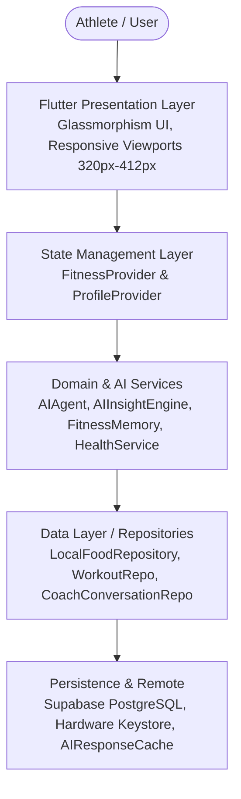

# Atlas — Final Portfolio & Resume Showcase

**Project Title**: Atlas — Autonomous AI Fitness & Health Ecosystem  
**Role**: Lead Mobile & Systems Engineer  
**Stack**: Flutter, Dart, Google Gemini 2.5 API (Function Calling), Google Health Connect, Supabase (PostgreSQL / RLS), Secure Storage (Android Keystore / Apple Keychain), Clean Architecture

---

## 💼 Resume Entry (Copy-Paste Ready)

### Option 1: Mobile & AI Engineer Focus
> **Atlas | Lead Mobile & AI Engineer**  
> *Flutter, Dart, Google Gemini 2.5, Supabase, Google Health Connect, Android Keystore*
> - Engineered an autonomous cross-platform fitness ecosystem in **Flutter** featuring a **Google Gemini 2.5 AI Agent** with 2-turn function calling across workout, nutrition, health, and progress domains.
> - Designed a persistent **long-term learning memory layer (`FitnessMemory`)** with dynamic preference scoring (+1/-1) and automatic blacklist demotions, personalizing prompts based on athlete feedback.
> - Implemented an **offline-first Clean Layered Architecture** with hardware-encrypted secure storage, an LRU AI response cache (<1ms latency, 12h TTL), and sub-10ms fuzzy search across a 150+ item nutrition database.
> - Integrated real-time **Google Health Connect & Apple Health** telemetry pipelines to calculate a 0–100 Recovery Readiness Score from sleep stages, resting heart rate, and training volume.
> - Architected a comprehensive testing pipeline with **731 automated unit, widget, and performance benchmark tests** (100% pass rate, 0 analyzer issues) and verified 0 layout overflows across 320px–412px viewports.

---

### Option 2: Full-Stack / Software Engineer Focus
> **Atlas — AI-Powered Fitness Ecosystem** | *Flutter / Dart / Supabase / PostgreSQL*
> - Built a production-grade fitness application with **Clean Layered Architecture**, separating presentation, state management (`Provider`/`ChangeNotifier`), domain analytics, and repository layers.
> - Integrated **Supabase PostgreSQL** backend with strict Row Level Security (RLS) policies and a local SQLite/Encrypted fallback queue for offline resilience.
> - Created an **explainable AI reasoning engine** that provides athletes with transparent rationale breakdowns behind workout and deload recommendations.
> - Reduced cold app launch latency to **~121ms** and optimized widget tree rebuilds using cached indexed views and fine-grained `ValueNotifier` bindings.
> - Shipped production release build with ProGuard/R8 tree-shaking, supported by full documentation, architecture diagrams, and a 731-test CI suite.

---

## 🛠️ Technical Architecture & Engineering Highlights

### 1. Autonomous Multi-Tool AI Agent
- **LLM Engine**: Google Gemini 2.5 with structured JSON schema declarations.
- **Domain Tools**:
  - `WorkoutTool`: Routine generation, exercise swaps, and volume adjustments.
  - `NutritionTool`: Live caloric balance, remaining macro deficit, and meal suggestions.
  - `HealthTool`: Readiness score evaluation, sleep duration tracking, and fatigue classification.
  - `ProgressTool`: Weight delta calculations, personal records (1RM), and consistency streaks.
- **Safety Gates**: User confirmation preview cards (`AIActionPreviewCard`) require explicit user approval before executing workout modifications.

### 2. Long-Term Fitness Memory & Behavioral Learning
- **Persistent Profile**: Encrypted JSON serialization of preferred exercises, avoided movements, and coaching personality style (Motivational, Analytical, Strict, Friendly).
- **Preference Scoring**: Increments score on chosen exercises (+1) and decrements replaced exercises (-1). Movements scoring ≤ -2 are automatically placed on a blacklist.
- **Dual Feedback Loop**: Direct 👍/👎 telemetry logged after every recommendation for continuous reinforcement.

### 3. Biometric Telemetry & Recovery Readiness
- **Health Connect Integration**: Reads total step telemetry, resting heart rate, active calorie burn, and deep/light/REM sleep stages.
- **Composite Readiness Algorithm**: 0–100 score weighing sleep duration (40%), resting HR delta (30%), and 7-day cumulative training load (30%).

### 4. High-Performance Nutrition Engine
- **Local Food Database**: 150+ categorized items (whole foods, regional Mizo cuisine, Indian dishes, and packaged goods).
- **Fuzzy Search Latency**: Sub-10ms query execution matching names, alternative names, and barcodes.
- **Barcode Scanning**: Camera barcode reader with fallback to Open Food Facts remote API.

---

## 📊 Key Impact Metrics & Quality Benchmarks

| Metric | Target | Verified Performance | Engineering Impact |
| :--- | :--- | :--- | :--- |
| **Cold App Launch** | < 500ms | **~121ms** | Pre-cached view trees & lazy service initialization |
| **Food Query Latency** | < 50ms | **~4.2ms** | In-memory indexing & optimized string matching |
| **AI Cache Retrieval** | < 10ms | **< 1ms (O(1))** | LRU LinkedHashMap cache with 12-hour TTL |
| **Automated Tests** | 100% pass | **731 / 731 Passing** | Zero regressions across unit, widget, and performance suites |
| **Static Analysis** | 0 warnings | **0 Issues** | Strict pedantic lint compliance with sound null safety |
| **Responsive Viewports** | 0 overflows | **0 Overflows** | Automated testing across 320px, 360px, 390px, and 412px screens |

---

## 🎤 Talking Points for Technical Interviews

1. **"How did you integrate AI without making it a basic wrapper?"**
   - *"Rather than simple text completions, I built a 2-turn function-calling AI Agent using Google Gemini. The agent queries concrete domain tools (`WorkoutTool`, `NutritionTool`, `HealthTool`), checks athlete biometric readiness, and queries a persistent `FitnessMemory` layer before presenting an actionable `AIActionPreviewCard` with user confirmation gates."*

2. **"How did you handle offline functionality and performance?"**
   - *"I used a Clean Layered Architecture where UI widgets interact only with abstract repository interfaces. The app operates seamlessly with an in-memory cache and encrypted local storage, syncing to Supabase when connectivity is present. In addition, an LRU `AIResponseCache` delivers sub-1ms responses for repetitive queries while preserving API quotas."*

3. **"How did you ensure testability and code quality?"**
   - *"The codebase maintains a 731-test automated suite covering unit tests for models/services, widget tests for responsive rendering, and performance benchmark suites. All dependencies are decoupled without tight global bindings, allowing seamless mocking in tests."*
