# Atlas: AI Fitness Coach

Atlas is a Flutter application for Android that combines workout tracking, outdoor run and ride tracking, step and health data, hydration, nutrition logging (barcode, photo and manual), a community, and an AI coach. It uses a Supabase backend, and a Gemini model that is reachable only through a server-side function. It was built as the project for **UCS503 Software Engineering Lab** (Thapar Institute of Engineering and Technology, Patiala; Group 3Q23).

## Download Atlas

<table>
<tr>
<td align="center" width="50%">

### Android phone (recommended)

**[Download ARM64 APK](https://github.com/BenjaminLRD/Atlas-app/releases/latest/download/app-arm64-v8a-release.apk)**

About 66 MB. Works on almost every Android phone made since 2017.

</td>
<td align="center" width="50%">

### Older phones and emulators

[ARMv7 APK](https://github.com/BenjaminLRD/Atlas-app/releases/latest/download/app-armeabi-v7a-release.apk) (about 59 MB, older 32-bit phones)

[x86_64 APK](https://github.com/BenjaminLRD/Atlas-app/releases/latest/download/app-x86_64-release.apk) (about 69 MB, Android emulators on PC)

</td>
</tr>
</table>

Not sure which one? Choose **ARM64**. Requires Android 8.0 or newer. All files are also on the [Releases page](https://github.com/BenjaminLRD/Atlas-app/releases/latest).

**Install in four steps**

1. Open the download link on your phone and save the file.
2. Open the downloaded `.apk` (from the browser's download list or the Files app).
3. If Android says it cannot install from this source, tap **Settings** and switch on **Allow from this source** for your browser or file manager, then go back and tap **Install**.
4. Open Atlas and choose **Explore in Showcase Mode** to try it without an account.

> The APKs are **debug-signed** and meant for academic demonstration and sideloading, not Play Store distribution. Because they are installed outside the Play Store, Android may show an "unknown app" or "Play Protect" warning. Atlas has not been tested on a physical phone (see [Testing](#testing-and-verified-results)).


> **Status in one paragraph.** Atlas is a finished academic project, not a store-published product. The release APKs are **debug-signed** and are meant for sideloading and demonstration; they are not Play Store ready. The software was verified with static analysis, automated tests and live tests of the Showcase AI pathway. It has **not** been tested on a physical Android phone, and the signed-in backend paths (including Row Level Security) were not verified against the live backend. See [Testing](#testing-and-verified-results) and [Known limitations](#known-limitations).

## Contents

0. [Download Atlas](#download-atlas)
1. [Overview and problem statement](#overview-and-problem-statement)
2. [Objectives](#objectives)
3. [Features](#features)
4. [Screenshots](#screenshots)
5. [Technology stack](#technology-stack)
6. [System architecture](#system-architecture)
7. [Application and backend data flow](#application-and-backend-data-flow)
8. [AI integration architecture](#ai-integration-architecture)
9. [Database and Supabase](#database-and-supabase)
10. [Security and privacy](#security-and-privacy)
11. [Testing and verified results](#testing-and-verified-results)
12. [Build and installation](#build-and-installation)
13. [APK download](#apk-download)
14. [Known limitations](#known-limitations)
15. [Future improvements](#future-improvements)
16. [Final academic report](#final-academic-report)
17. [Repository layout](#repository-layout)
18. [Credits](#credits)

## Overview and problem statement

Fitness applications usually do one job well. Training plans, food logging, step and route tracking, progress review and motivation are spread over separate apps, so the user has to connect them by hand. Coaching advice is often generic because it does not use the user's profile and recent activity. Manual food logging is slow, which makes it hard to keep up.

Atlas puts these parts in one application that shares the same data, and adds an AI coach that can use that data. It is built to be honest about what it does not know: a missing nutrient or health reading is shown as unavailable, never as zero, and AI output is labelled as an estimate.

## Objectives

- A reliable training flow: choose a workout, perform it with set and rest timers, keep a history.
- GPS run and ride tracking with a route, and a privacy mask when an activity is shared.
- Step counting that does not double count the phone and Health Connect.
- Fast food logging by barcode, photo or manual entry, without presenting unknown values as zero.
- An AI coach and AI scanners reached through a secure server-side path, with clear errors.
- A **Showcase Mode** that lets anyone try the app without an account, using clearly labelled sample data kept apart from real records.
- Verification by static analysis and automated tests, with an honest statement of what was not verified.

## Features

All features below exist in the source code. "Verified" means covered by automated tests; see [Testing](#testing-and-verified-results) for what was and was not tested live or on a device.

**Training**
- Weekly plan, exercise library (72 movements with instructions and images), active workout sessions with set and rest timers, 30-day challenge, custom workouts, workout history and summaries.
- Outdoor running and cycling: GPS tracking with pause and resume, planned stops, OpenStreetMap route display, cardio history, route privacy modes (hide 200 m, hide 500 m, full route, no route), sharing to the community.

**Health and activity**
- Step counter with a per-day ledger, Health Connect reads (steps, sleep, heart rate, resting heart rate, HRV, active calories, weight, body fat, lean mass), hydration goal and log, sleep and recovery insights.

**Nutrition**
- Food catalogue and manual entry, barcode lookup against Open Food Facts, AI photo estimate, meal preps, recipes, custom meals, calorie and macronutrient totals. Totals add only known values and are marked partial when an ingredient has no value.

**AI**
- AI coach with bounded conversation context (last eight turns plus a short note of older topics), AI food scanner, AI gym machine identification, and the Showcase AI pathway.

**Community and progress**
- Feed with likes, comments, reports and blocks, friends, rankings (milestone based, evaluated on the server), challenges, profiles and profile pictures.

**Accounts and billing**
- Email and password sign-in with Supabase Auth, onboarding with permission explanations, account deletion through a server function, plans screen with RevenueCat integration, and a demonstration checkout that never grants an entitlement.

**Showcase Mode**
- Opens without an account, shows sample data labelled as sample, disables writes to real records, and uses the restricted anonymous AI path.

## Screenshots

These are **renders of the real Atlas screens in Showcase Mode**, produced by running the application's own widgets at a phone-sized viewport (390 x 844 logical pixels) with the Roboto font. They are not photographs of a phone, and the content shown is sample data. The AI Coach image shows a banner "AI is not set up in this build" because the rendering environment has no backend settings compiled in; the conversation in it is bundled sample content, not a live AI answer.

<table>
  <tr>
    <td align="center">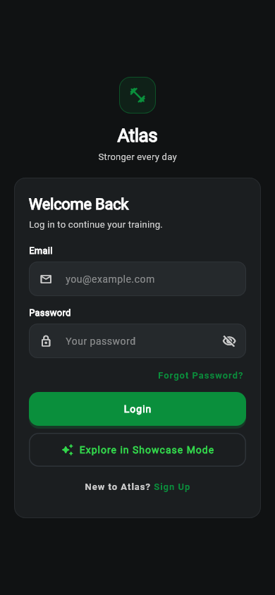<br><sub>Login and Showcase entry</sub></td>
    <td align="center">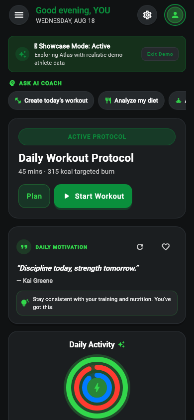<br><sub>Home</sub></td>
    <td align="center">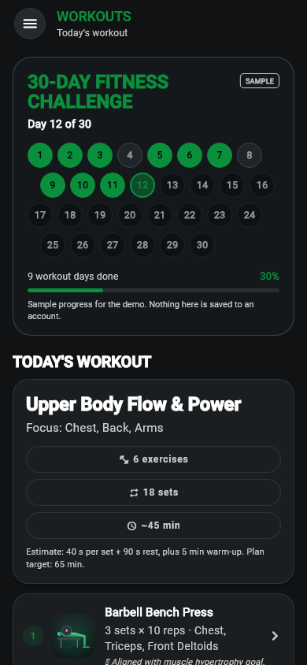<br><sub>Workouts and 30-day challenge</sub></td>
    <td align="center">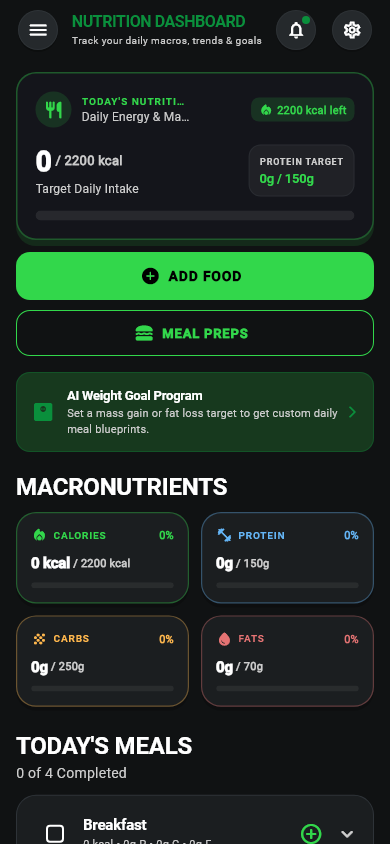<br><sub>Nutrition</sub></td>
  </tr>
  <tr>
    <td align="center">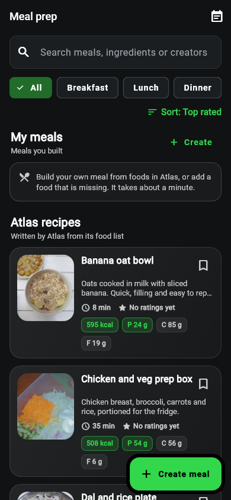<br><sub>Meal prep and recipes</sub></td>
    <td align="center">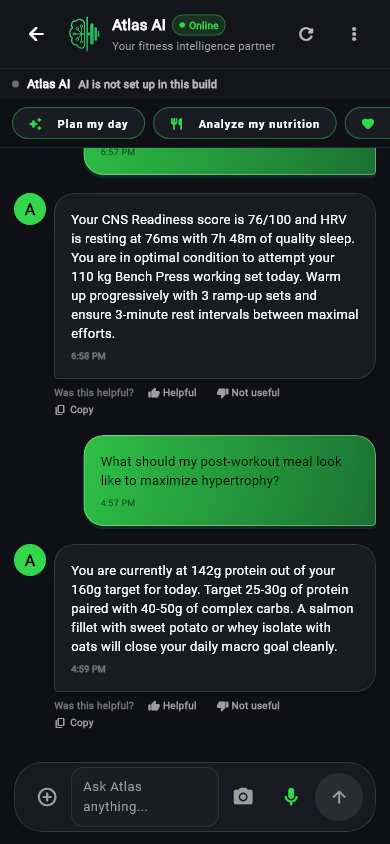<br><sub>AI Coach (sample chat)</sub></td>
    <td align="center">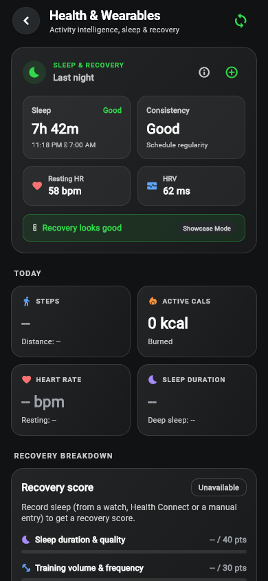<br><sub>Health and Wearables</sub></td>
    <td align="center">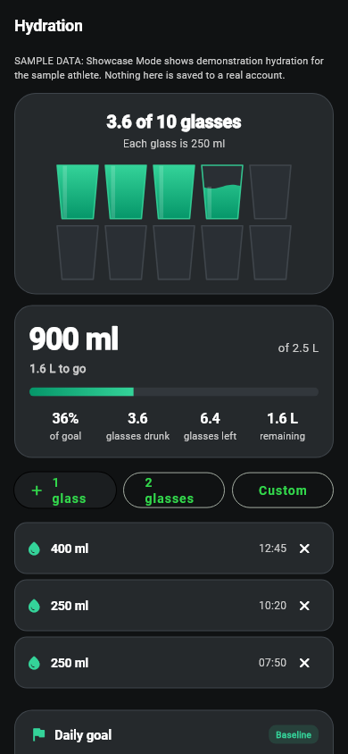<br><sub>Hydration</sub></td>
  </tr>
  <tr>
    <td align="center">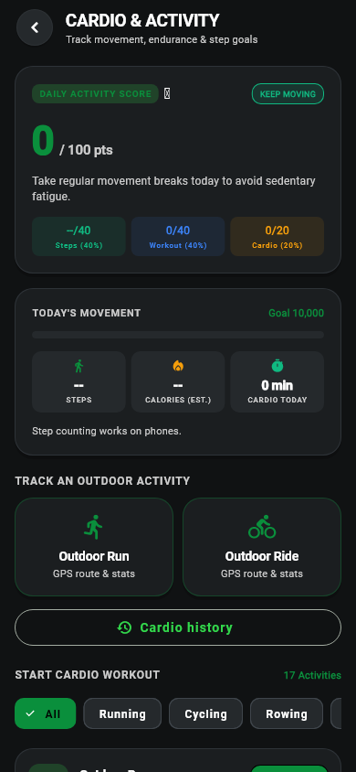<br><sub>Cardio and activity</sub></td>
    <td align="center">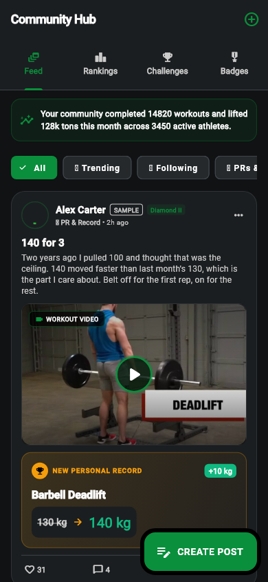<br><sub>Community</sub></td>
    <td align="center">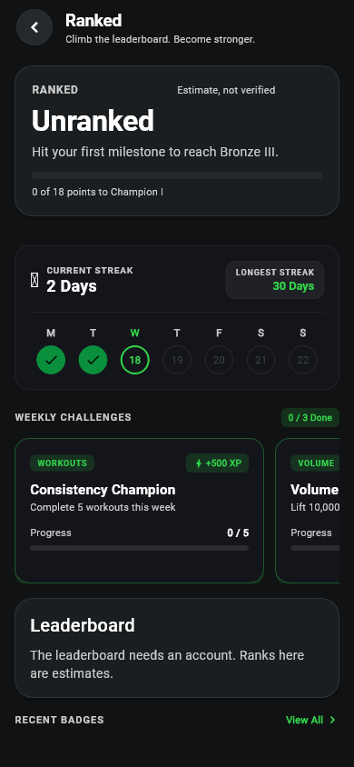<br><sub>Ranked</sub></td>
    <td align="center">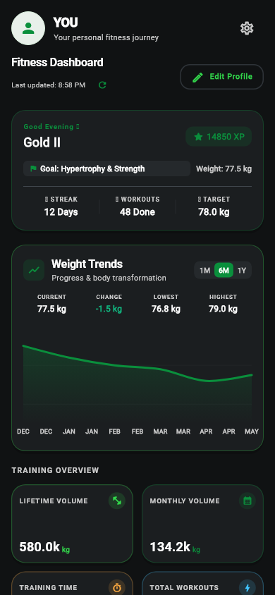<br><sub>Profile</sub></td>
  </tr>
</table>

## Technology stack

| Area | Technology |
|---|---|
| Client | Flutter, Dart (SDK constraint `^3.12.2`); Android minimum SDK 26 (Android 8.0) |
| State | `ChangeNotifier` providers and `ValueNotifier`; no external state-management package |
| Backend | Supabase: Auth, PostgreSQL with Row Level Security, Storage, Edge Functions (Deno) |
| AI | Google Gemini `gemini-2.5-flash`, called only from the `ai-proxy` Edge Function |
| Food data | Open Food Facts public API; `mobile_scanner` for barcodes |
| Maps | `flutter_map` with OpenStreetMap tiles |
| Sensors and health | `geolocator` (GPS), `pedometer` (steps), `health` (Health Connect), `camera`, `image_picker` |
| Billing | RevenueCat (`purchases_flutter`) and a demonstration checkout |
| Storage | `shared_preferences`, `flutter_secure_storage` |
| Charts and UI | `fl_chart`, `google_fonts`, `cached_network_image`, `video_player` |
| Tooling | `flutter analyze`, `flutter test`, Graphify (architecture analysis), Node.js (local test of the Edge Function) |

## System architecture

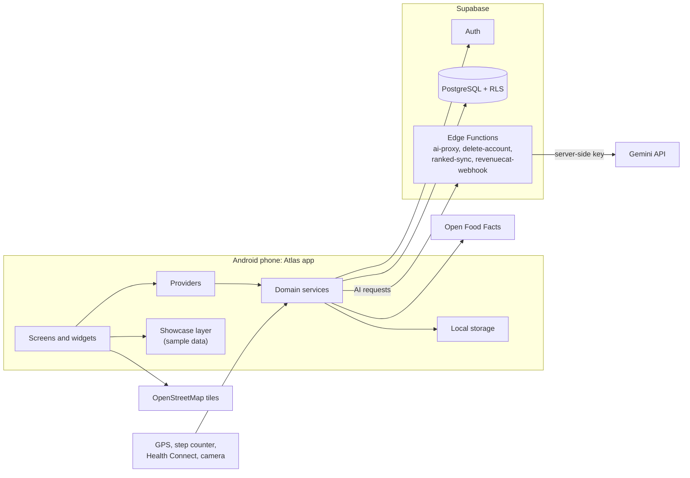

The application is organised in layers: screens and widgets, state holders, domain services, and data (local storage and cloud repositories). The layering was **measured with Graphify** from the code (1,306 imports between files in `lib/`); the numbers, and the places where the code departs from a strict layering, are in [docs/diagrams/flutter_module_dependencies.md](docs/diagrams/flutter_module_dependencies.md). The full system diagram is in [docs/diagrams/system_architecture.md](docs/diagrams/system_architecture.md).

## Application and backend data flow

Local first, then synchronised: user actions update local state and storage immediately; for a signed-in user the cloud repositories queue the writes (upsert or delete per table) and send them to Supabase under Row Level Security. In Showcase Mode nothing is written to real records.

Feature-level flows (steps, GPS and route privacy, nutrition and barcode lookup, storage and synchronisation) are drawn in [docs/diagrams/feature_data_flows.md](docs/diagrams/feature_data_flows.md). Two examples of what they record:

- **Steps:** the phone counter is cumulative since boot, so `StepLedger` adds the positive difference between readings and holds a counter drop for 30 seconds before accepting a reset. Health Connect gives a daily total. The day's value is the **larger** of the two, never their sum.
- **GPS:** `CardioTracker` rejects fixes with an accuracy worse than 30 m and jumps that imply an impossible speed, records nothing while paused, and produces a `CardioResult`. `RoutePrivacy` masks the route before it is shared.

## AI integration architecture

Atlas **does not train a model**. It sends requests to Google's hosted Gemini model through the `ai-proxy` Edge Function, which is the only component that holds the Gemini key.

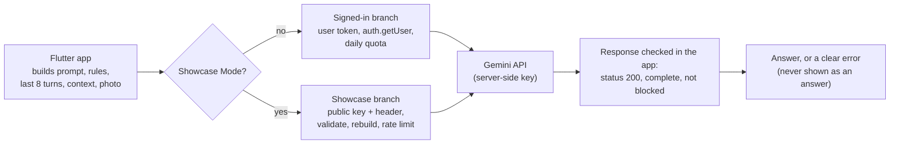

- **Context.** The coach request carries the fixed safety rules, the last eight turns (each limited to 600 characters), a short note of older topics marked as untrusted context, and profile and activity context where it exists.
- **Signed-in branch.** Verifies the user, counts the request against a daily quota (coach 10 free and 400 pro; food scan 3 free and 100 pro), then calls Gemini.
- **Showcase branch.** Selected only by the header `x-atlas-showcase: 1`. It is off unless a server secret enables it, requires a project public key, accepts only the features `coach` and `food_scan` and the model `gemini-2.5-flash`, rebuilds the request from validated parts (client tools, safety settings, thinking configuration and candidate count are dropped), fixes the system instruction on the server, limits size (64 KB text, 1.25 MB with a photo) and output (2,048 tokens), and applies per-client and global rate limits. It reads and writes no user data.
- **Food scan and machine scan.** A photo (maximum 1280 px) goes through the same path. Unknown values are `null`; a zero counts only if the model lists it as confirmed. The result is shown as an AI estimate.
- **What the AI is not.** Answers are generated text. They are not medically validated and can be wrong.

Sequence diagrams for the three flows, the limits, and the file list are in [docs/diagrams/ai_request_flows.md](docs/diagrams/ai_request_flows.md).

## Database and Supabase

14 tables, all with Row Level Security (`supabase/migrations/`): `profiles`, `workout_session_records`, `workout_history_records`, `cardio_session_records`, `nutrition_day_records`, `fitness_goal_records`, `ai_usage`, `ranked_profiles`, `ranked_claims`, `ranked_stat_rules`, `community_posts`, `community_likes`, `community_comments`, `user_blocks`, `content_reports`. The application's own records are stored as a key plus a `jsonb` document so the client model can evolve; ranking and community data use typed columns. Every user-owned table references `auth.users` with cascade deletion. Edge Functions: `ai-proxy`, `delete-account`, `ranked-sync`, `revenuecat-webhook`. The entity-relationship diagram and function table are in [docs/diagrams/supabase_backend.md](docs/diagrams/supabase_backend.md).

A proposed migration for community recipes and ratings exists in `supabase/proposed/` and has **not** been applied.

## Security and privacy

- **No AI key in the client.** The Gemini key is a Supabase secret. The built APK was scanned for Gemini-style keys, secret keys, service-role references and private keys, and none were found. The only values compiled into the app are the Supabase project address and its public key.
- **Row Level Security** on every user table (`auth.uid() = user_id`); the subscription tier can be written only by the server.
- **Account deletion** removes uploaded files and the auth user in a server function; rows follow by cascade.
- **Route privacy:** start and end of a shared route can be hidden.
- **Showcase isolation:** sample data is labelled, uses separate storage keys, and cannot write real records; the Showcase AI request carries no user token or identifier.
- **Permissions** (camera, location, activity recognition, Health Connect) are explained in onboarding before they are requested.
- **Known weakness:** Showcase rate limits are kept in memory per function instance and identify a client by network address. They are suitable for a controlled demonstration, not for a public release.

## Testing and verified results

The levels of testing are kept separate on purpose. A passing widget test is not evidence that a feature works on a phone.

| Level | Result |
|---|---|
| Static analysis: `flutter analyze --fatal-infos --no-pub` | No issues |
| Automated tests (unit and widget), `flutter test --no-pub` | **3,460 passed, 0 failed, 11 skipped** |
| Showcase UI smoke test (every drawer destination and key screens, Showcase and normal mode) | 64 of 64 passed |
| Layout audit (screens at 320 and 360 dp, text scale 1.5) | Part of the suite; found and fixed overflows |
| Local run of the `ai-proxy` function logic with stubs (Node.js, not the Deno runtime) | 26 of 26 cases passed |
| **Live** Showcase AI test with the real Flutter client against the deployed backend | Passed: two-turn context retained, photo request, machine scanner (recognised an adjustable bench), food scanner (correctly returned "No food detected" for a gym photo), invalid key rejected, oversized photo refused with a clear error |
| **Live** Showcase backend script (`tool/test_showcase_ai.ps1`) | 7 of 7 cases passed |
| Release APK build | Succeeded; contains the Supabase address and public key; no AI or privileged key found |
| **Physical Android device** | **Not completed.** GPS, background cardio, step counting, Health Connect, the camera and touch layout are unverified on hardware |
| **Live signed-in** AI, Supabase Row Level Security and signed-in synchronisation | **Not verified** against the live backend |

The 11 skipped tests need opt-in credentials or live services (for example Supabase integration tests and a live Gemini vision call). They are not counted as passed. The defects found and fixed during testing are listed in the report, section 5.1.

Manual device test cases (DT-01 to DT-09) are listed in the report, section 5.2.4.

To run the checks yourself:

```bash
flutter analyze --fatal-infos --no-pub
flutter test --no-pub
# Edge Function logic, with Node.js 22 or later (stubs, no network):
node --test tool/ai_proxy_local_test/run.mjs
# Live check of the deployed Showcase function (needs a .env; Windows PowerShell):
powershell -File tool/test_showcase_ai.ps1
```

## Build and installation

Requirements: Flutter SDK with a Dart version that satisfies `^3.12.2`, Android SDK, and a Supabase project (for backend features).

```bash
git clone https://github.com/BenjaminLRD/Atlas-app.git
cd Atlas-app
flutter pub get
```

Create a `.env` file from [.env.example](.env.example) with your own Supabase project address and public (anon) key. Everything in this file is compiled into the app and can be read from the APK, so put only public values in it; never commit it (it is git-ignored).

```bash
# run on a connected Android phone or an emulator
flutter run --dart-define-from-file=.env

# release APKs, one per CPU architecture
flutter build apk --release --no-pub --dart-define-from-file=.env --split-per-abi
# or, on Windows, the project's wrapper that also checks the build
powershell -File tool/build_release_apk.ps1 -SplitPerAbi
```

Without `--dart-define-from-file=.env` the app starts but reports that the backend is not configured.

Backend setup (migrations, secrets, deploying the four Edge Functions) is described in [docs/RELEASE_ANDROID.md](docs/RELEASE_ANDROID.md) and [docs/SHOWCASE_AI.md](docs/SHOWCASE_AI.md). To use the Showcase AI, deploy `supabase/functions/ai-proxy/index.ts`, set the secret `SHOWCASE_AI_ENABLED=true`, and check it with `tool/test_showcase_ai.ps1`.

On Windows the Kotlin incremental compiler can fail when the pub cache and the project are on different drives; temporarily adding `kotlin.incremental=false` to `android/gradle.properties` avoids it.

## APK download

Release APKs (built 18 November 2026, version 1.1.0+2) are for sideloading:

| File | Architecture | Size |
|---|---|---:|
| `app-arm64-v8a-release.apk` | ARM64 (most modern phones) | 69,098,823 bytes |
| `app-armeabi-v7a-release.apk` | ARMv7 | 62,127,735 bytes |
| `app-x86_64-release.apk` | x86_64 (emulators) | 72,864,043 bytes |

SHA-256 checksums: arm64 `6c929a1649897596ad901ccdff27c07ec98c7c656c155c27ca85cc6b1922815e`, armv7 `c9cb0c4e8143750a31a7c6157b5773f910f7691bc618e7f370fbab383e32812f`, x86_64 `770f63a8c6496199a45148312fd3de499b9f8ed7a107c3d4fa2884538d6ad884`. The files are published as GitHub Release assets (see [Download Atlas](#download-atlas)), not stored in the Git history. They are **debug-signed** (no release signing key was configured), so Android may warn when you install them, and they are **not suitable for the Play Store**. To install: copy the arm64 file to the phone, allow installation from that source, open it, then choose "Explore in Showcase Mode" to try the app without an account.

## Known limitations

- No physical-device testing was completed (GPS, background recording, steps, Health Connect, camera, touch layout).
- Signed-in AI, Row Level Security and signed-in synchronisation were not verified against the live backend.
- Showcase rate limits are not durable (in memory, per function instance).
- The APKs are debug-signed.
- Community recipe ratings need a backend table that is only proposed (not applied); in normal mode that section says it is not switched on.
- Some placeholder domains and a few "coming soon" actions remain; the notification permission is declared but no notification feature uses it yet.
- An on-device pose-based form-coach module exists in the code base but is outside the verified scope of this report.
- The AI is a hosted model: answers and food estimates are not medically validated.
- The Graphify measurement shows imports that go against the intended layering (for example widgets importing screens); they are listed in the diagram page and do not change behaviour.
- No performance benchmark, user study or accuracy measurement was carried out.

## Future improvements

- Complete a physical-device test pass and add real device screenshots.
- Create a release signing key and publish through a store.
- Move Showcase rate limits into a database table and add an abuse gate before any public release.
- Apply the reviewed community recipes and ratings migration and test signed-in flows and Row Level Security live.
- Notifications and reminders, richer wearable integration, an iOS release.
- A user study to measure the usefulness and accuracy of the coach and food estimates.

## Final academic report

The final project report (UCS503 Software Engineering Lab, END-semester evaluation) follows the course template: software bid, project overview, use cases, activity and swimlane diagrams, data flow diagrams, an IEEE-format SRS, user stories, class, sequence, collaboration and state diagrams, component and deployment diagrams, screenshots, and testing.

- [Atlas_Final_Project_Report.pdf](docs/Final_Project_Report/Atlas_Final_Project_Report.pdf)
- [Atlas_Final_Project_Report.docx](docs/Final_Project_Report/Atlas_Final_Project_Report.docx) (editable)

The report and this README describe the verified implementation. Some other documents in `docs/` (for example the platform vision and research notes) are earlier design and idea documents; where they differ from the report, the report and this README are authoritative.

## Repository layout

```
lib/                 Flutter application (screens, widgets, providers, services, models, data)
test/                Unit, widget, contract and opt-in live tests
supabase/            Migrations, Edge Functions, and a proposed (not applied) migration
tool/                Release build script, Showcase AI check, local Edge Function test
docs/                Final report, architecture diagrams, screenshots, release and Showcase notes
android/ ios/ ...    Platform projects
```

Architecture diagrams are in [docs/diagrams/](docs/diagrams/): [system](docs/diagrams/system_architecture.md), [Flutter module dependencies (Graphify)](docs/diagrams/flutter_module_dependencies.md), [Supabase backend](docs/diagrams/supabase_backend.md), [AI request flows](docs/diagrams/ai_request_flows.md), [feature data flows](docs/diagrams/feature_data_flows.md). The dependency numbers can be reproduced with `graphify update .` and `python docs/diagrams/module_dependencies.py`.

## Credits

- Project team (Group 3Q23): Rohandeep Singh (1024170087), Gulnaz Singh (1024170109), Lalramdina Zadeng (1024170084).
- Guide: Sandeep Kaur, Computer Science and Engineering Department, TIET, Patiala.
- Third-party data and services: Open Food Facts (product data), OpenStreetMap contributors (map tiles), Supabase, Google Gemini API, RevenueCat. Package licences are listed in [THIRD_PARTY_NOTICES.md](THIRD_PARTY_NOTICES.md).
- No licence file is included in this repository; no licence is granted by default.
