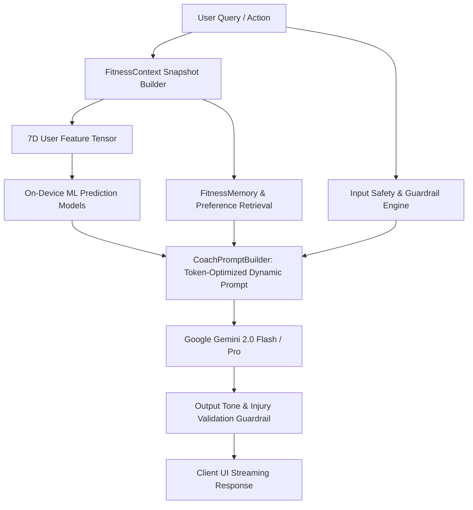

# Atlas — AI & Machine Learning Architecture Specification

## 1. Architectural Philosophy

Atlas is built on a **Hybrid Intelligence Framework** that unifies deterministic heuristic validation, on-device machine learning models, and deep large language model reasoning (Google Gemini 2.0).



---

## 2. Dynamic Context Building (`FitnessContext`)

The `FitnessContext` compiles a comprehensive snapshot of the athlete's current state before every AI generation:

```dart
class FitnessContext {
  final UserProfile userProfile;             // Physical traits, goals, experience
  final UserGoal userGoal;                   // Target weight, target macros, timeline
  final List<WorkoutHistory> workoutHistory; // Recent 14-day volume and RPE load
  final NutritionSummary nutritionSummary;   // Protein hit rate, calorie delta
  final UserProgress userProgress;           // Streak, Rank, total XP
  final RecoveryState recoveryState;         // Autonomic score (0-100), CNS fatigue
  final ProgressSummary progressSummary;     // 1RM PRs, volume progression curves
  final DigitalAthlete? digitalAthleteTwin;  // Multi-domain athlete twin model
}
```

---

## 3. Persistent Memory System (`FitnessMemory`)

Atlas equips the AI Coach with long-term episodic and semantic memory:

1. **Explicit Preference Capture**: Foods explicitly liked/disliked, favored training splits, equipment limitations.
2. **Implicit Behavioral Feedback**: Automatic score adjustments when users swap exercises or skip prescribed volume.
3. **Memory Decay & Retention**: Older memories decay gracefully over time while repeated positive reinforcement cements high-confidence preferences.
4. **Context Injection**:
   ```
   [LEARNED USER PREFERENCES & FITNESS MEMORY]
   - Disliked Exercises: Behind-the-Neck Press, Barbell Hack Squat
   - Preferred Exercises: Incline Dumbbell Press, Weighted Dips
   - Dietary Bias: High Protein, low dairy tolerance
   - Historical Recommendation Satisfaction Rate: 94.2%
   ```

---

## 4. Safety Guardrails & Fallback Mechanisms

To ensure athlete safety and clinical sanity, Atlas applies multi-layered guardrails:

- **Calorie Minimum Floor**: Never recommends daily calories below basal metabolic floor ($1,200\text{ kcal}$ female, $1,500\text{ kcal}$ male).
- **Injury & Joint Contraindication**: Automatically filters out joint-straining movements when pain or tendonitis is flagged (e.g. replacing Barbell Bench Press with Neutral Grip DB Press for shoulder impingement).
- **Autonomic Overtraining Interception**: When recovery score drops below 45/100 and consecutive heavy sessions exceed 3, AI automatically enforces an active recovery or deload protocol.
- **Tone & Empathy Validation**: Enforces empowering, direct, and non-judgmental coaching persona.

---

## 5. Machine Learning Prediction Models

Atlas runs specialized predictive models to drive real-time fitness adaptation:

| Model | Purpose | Input Dimensions | Inference Time |
|---|---|---|---|
| **`WorkoutRecommendationModel`** | Predicts optimal daily split and volume | 7D Feature Tensor + Recovery Score | $< 12\text{ms}$ |
| **`StrengthPredictionEngine`** | Projects 4, 8, and 12-week 1RM compound curves | Historical Overload + Recovery Rate | $< 5\text{ms}$ |
| **`MovementQualityModel`** | Biomechanical grading of 33 pose landmarks | Joint Angles, ROM, Velocity, Symmetry | $< 18\text{ms}$ |
| **`EngagementPredictionEngine`** | Forecasts athlete churn risk & habit rescue | Days Inactive, Missed Macro Goals, Streak | $< 8\text{ms}$ |

---

## 6. Prompt Engineering & Token Optimization

`CoachPromptBuilder` compiles dynamic, token-efficient system directives:

```
[SYSTEM DIRECTIVES]
You are Atlas, an elite AI Strength Coach & Sports Nutritionist.
Your advice must be grounded in exercise physiology, progressive overload principles, and the user's live telemetry.

[ATHLETE STATE]
- Name: Alex Lalremruata | Age: 26 | Weight: 77.5kg | Experience: Advanced
- Primary Goal: Hypertrophy & Strength
- Recovery Score: 88/100 (Optimal) | HRV: 76ms | Sleep: 8.1 hrs
- Recent Volume: 14,850 kg (Upper Push Session, 100% completed)
- Target Macros: 185g Protein (103% hit rate), 2,650 kcal

[PREDICTED ML INSIGHTS]
- Estimated Bench 1RM: 110.0kg (+4.2% monthly velocity)
- Optimal Circadian Window: Evening (17:30 - 19:30)

[OUTPUT REQUIREMENTS]
- Be concise, direct, motivating, and actionable.
- Format compound numbers cleanly with units (kg, kcal, reps).
```
