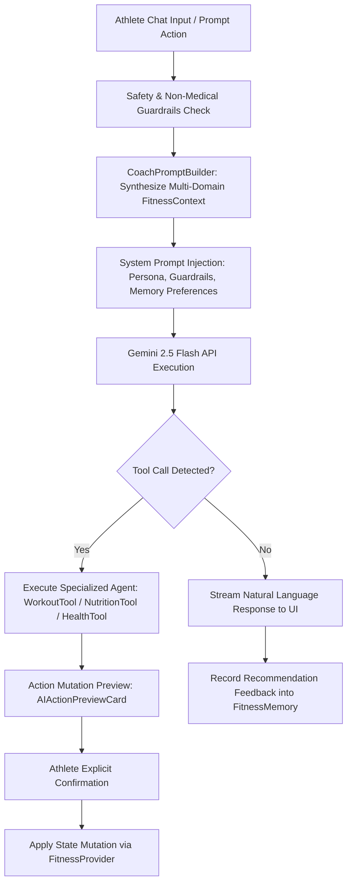
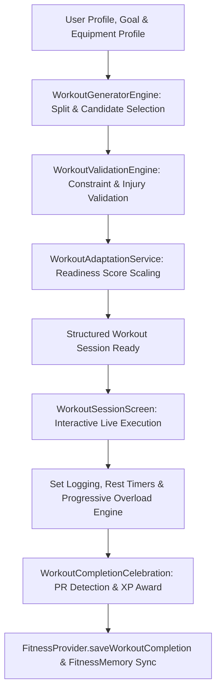
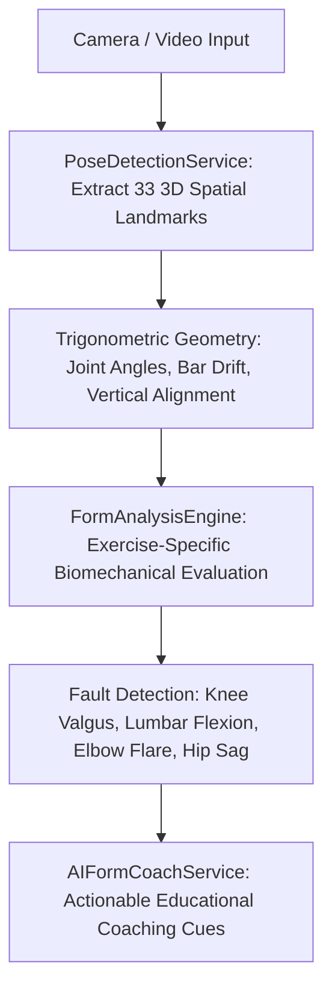
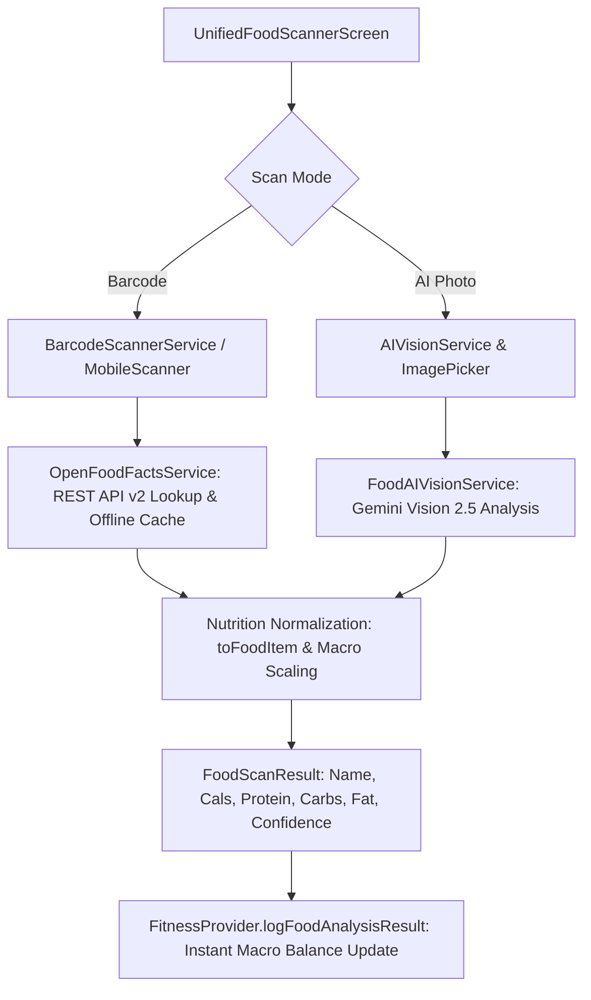
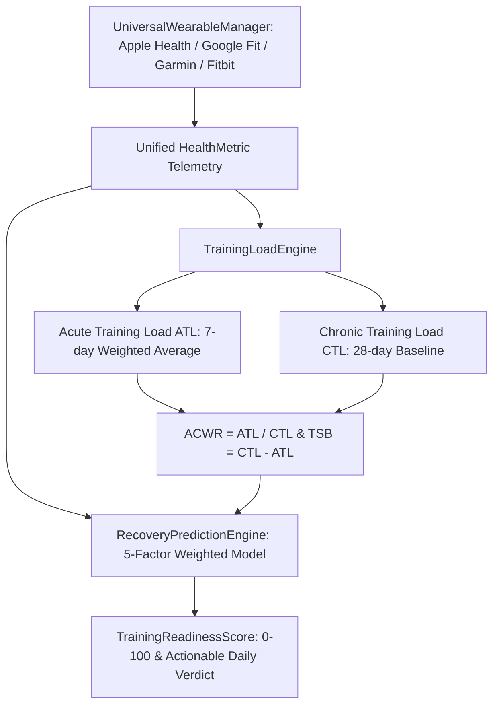

# Atlas — Technical Architecture & Pipeline Specification

## Table of Contents
1. [System Overview & Clean Layered Architecture](#1-system-overview--clean-layered-architecture)
2. [AI Intelligence & Tool-Calling Pipeline](#2-ai-intelligence--tool-calling-pipeline)
3. [Adaptive Workout Generation & Execution Pipeline](#3-adaptive-workout-generation--execution-pipeline)
4. [Computer Vision Exercise Form Biomechanics Pipeline](#4-computer-vision-exercise-form-biomechanics-pipeline)
5. [Multimodal Vision & Barcode Nutrition Pipeline](#5-multimodal-vision--barcode-nutrition-pipeline)
6. [Physiological Recovery & Training Load Engine](#6-physiological-recovery--training-load-engine)
7. [Data Persistence, Security & Offline-First Strategy](#7-data-persistence-security--offline-first-strategy)

---

## 1. System Overview & Clean Layered Architecture

Atlas follows a **Clean Layered Architecture** with strict unidirectional data flow and repository patterns, ensuring full decoupling between UI widgets, domain business logic, data persistence, and external AI/cloud services.

```
┌────────────────────────────────────────────────────────────────────────┐
│                          PRESENTATION LAYER                            │
│  Screens (Dashboard, AI Coach, Food Scanner, Workout Session, Recovery) │
│  Reusable Components (AppCard, AppButton, AppAnimation, ProgressRing)  │
└───────────────────────────────────┬────────────────────────────────────┘
                                    │
                                    ▼
┌────────────────────────────────────────────────────────────────────────┐
│                             DOMAIN LAYER                               │
│  State Management: FitnessProvider, ProfileProvider                    │
│  Domain Engines: WorkoutGeneratorEngine, TrainingLoadEngine,           │
│                  FormAnalysisEngine, RecoveryPredictionEngine          │
│  Intelligence: CoachPromptBuilder, FitnessMemory, CoachChatService     │
└───────────────────────────────────┬────────────────────────────────────┘
                                    │
                                    ▼
┌────────────────────────────────────────────────────────────────────────┐
│                          DATA / REPOSITORY LAYER                       │
│  Repositories: WorkoutRepository, NutritionRepository, ProfileRepo     │
│  Services: OpenFoodFactsService, BarcodeService, WearableManager       │
└───────────────────┬────────────────────────────────┬───────────────────┘
                    │                                │
                    ▼                                ▼
┌──────────────────────────────────────┐ ┌───────────────────────────────┐
│          LOCAL PERSISTENCE           │ │         CLOUD SERVICES        │
│  • SharedPreferences (Fast cache)    │ │  • Supabase (PostgreSQL + RLS)│
│  • Flutter Secure Storage (Keychain) │ │  • Google Gemini 2.5 Flash    │
│  • Offline Exercise & Food Catalogs  │ │  • OpenFoodFacts REST API     │
└──────────────────────────────────────┘ └───────────────────────────────┘
```

---

## 2. AI Intelligence & Tool-Calling Pipeline

The AI Coach agent operates as a multi-turn, stateful conversational agent equipped with structured function calling and behavioral memory.



### Key Stages:
1. **Context Synthesis (`CoachPromptBuilder`)**: Compiles real-time athlete profile, primary goal, 48-hour workout history, active nutrition balance (calories & protein remaining), physiological recovery telemetry (sleep, HRV, readiness score), and available gym equipment into a compact structured context payload.
2. **Safety & Non-Medical Guardrails**: Every query is evaluated against non-medical guardrails. The agent refuses clinical diagnosis and automatically attaches contextual safety advice when detecting soreness, joint strain, or acute fatigue.
3. **Action Confirmation**: State mutations (e.g. replacing a workout movement or altering calorie targets) generate structured `AIActionPreviewCard` widgets, requiring explicit athlete confirmation before mutating database records.
4. **Behavioral Memory (`FitnessMemory`)**: Tracks preferred exercises (+1 score on selection) and disliked movements (-1 score on substitution), ensuring continuous personalization across sessions.

---

## 3. Adaptive Workout Generation & Execution Pipeline



### Key Stages:
1. **Constraint-Aware Generation (`WorkoutGeneratorEngine`)**: Filters the 100+ movement library against the athlete's active `UserEquipmentProfile` (Commercial Gym, Home Dumbbells, Barbells, or Bodyweight) and target split (Push, Pull, Legs, Upper, Lower, Full Body).
2. **Biomechanical Validation (`WorkoutValidationEngine`)**: Validates candidate movements for split compliance, equipment availability, injury safety exclusions, and deduplication.
3. **Readiness Adaptation (`WorkoutAdaptationService`)**:
   - **Optimal (Score 70–100)**: 100% prescribed volume and full progressive overload.
   - **Caution (Score 50–69)**: Volume reduced by 1 set per movement (~80% volume).
   - **Deload (Score < 50)**: Volume reduced by 50% with light recovery intensity.
4. **Active Session Tracking**: Real-time elapsed duration, rest timer rings with sound/haptic cues, weight/rep logs, and 1RM calculation via the Brzycki equation:
   $$\text{1RM} = \text{Weight} \times \left(1 + \frac{\text{Reps}}{30}\right)$$

---

## 4. Computer Vision Exercise Form Biomechanics Pipeline



### Supported Movements & Biomechanical Thresholds:
- **Barbell Back Squat**:
  - Parallel Depth: Femur angle $\le 90^\circ - 100^\circ$ relative to horizontal.
  - Knee Valgus Ratio: Knee distance / Ankle distance $\ge 0.82$.
  - Torso Lean: Trunk forward lean angle $\le 40^\circ$.
- **Conventional Deadlift**:
  - Neutral Spine Angle: Lumbar spine angle $\ge 162^\circ - 170^\circ$.
  - Bar Horizontal Drift: Deviation $\le 0.15$ normalized frame units.
- **Barbell Bench Press**:
  - Elbow Flare Angle: Upper arm angle relative to torso $45^\circ - 65^\circ$.
- **Overhead Shoulder Press**:
  - Vertical Lockout: Elbow extension $\ge 155^\circ - 180^\circ$ with neutral lumbar alignment.

---

## 5. Multimodal Vision & Barcode Nutrition Pipeline



### Key Stages:
1. **Barcode Resolution**: Instant product lookup against the global OpenFoodFacts database with local caching for offline reliability.
2. **AI Meal Image Estimation**: Multimodal Gemini Vision analysis estimating portion weights, food classifications, and nutrient density.
3. **Macro Balancing**: Real-time recalculation of remaining daily calories and target protein requirements based on the athlete's Harris-Benedict BMR and TDEE profile.

---

## 6. Physiological Recovery & Training Load Engine



### 5-Factor Weighted Score Model:
1. **Workout Recovery (30%)**: Hours elapsed since last high-intensity session and muscle group recovery status.
2. **Sleep Duration & Quality (25%)**: Total hours slept vs 8-hour target with deep sleep ratio weighting.
3. **Heart Rate Variability (20%)**: Comparison of daily rMSSD against the athlete's 30-day baseline.
4. **Acute Training Load (15%)**: Workload stress penalty calculated via Acute:Chronic Workload Ratio (ACWR sweet spot: $0.8 - 1.3$).
5. **Nutrition Adherence (10%)**: Fulfillment percentage of daily calorie and protein recovery targets.

---

## 7. Data Persistence, Security & Offline-First Strategy

- **Offline-First Synchronization**: Local storage acts as the single source of truth for UI state. Remote mutations sync asynchronously with Supabase when network connectivity is available.
- **Row-Level Security (RLS)**: PostgreSQL tables (`profiles`, `workouts`, `nutrition_logs`, `memory_preferences`) enforce strict access control where users can only read and write their own records (`auth.uid() = user_id`).
- **Encrypted Local Storage**: Authentication tokens and sensitive keys are stored in hardware-backed storage (`flutter_secure_storage`).
- **Demo Mode Sandboxing**: `DemoModeService` provides isolated, deterministic presentation data for evaluation without risking data corruption or account overwriting.
