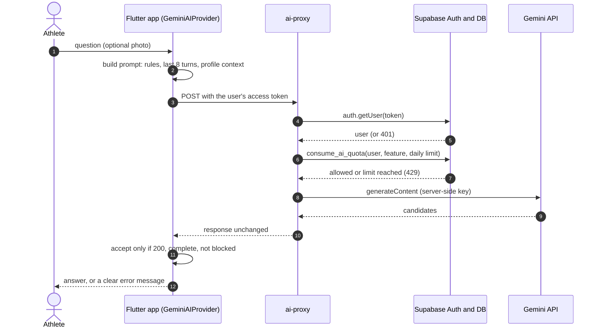
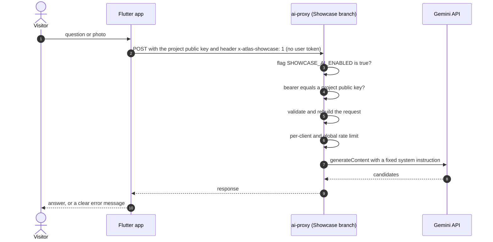
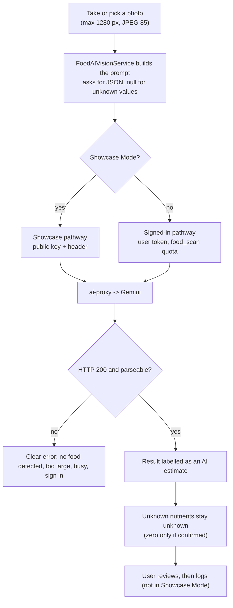

# AI request flows

Atlas does **not** train a model. It uses Google's hosted Gemini model `gemini-2.5-flash`, and only the `ai-proxy` Edge Function calls it. The application sends `{model, feature, request}` to the proxy, where `feature` is `coach` or `food_scan`.

## 1. AI Coach, signed-in user

Daily limits (counted per user and feature): coach 10 for the free tier and 400 for the pro tier; food scan 3 and 100.

## 2. Showcase Mode (no account)

What the Showcase branch enforces: only the features `coach` and `food_scan` and the model `gemini-2.5-flash`; roles limited to `user` and `model`; no function calls or file parts; at most 12 turns, 32,000 characters of text and one image; 64 KB for text-only requests and 1.25 MB with a photo; output capped at 2,048 tokens. Anything the client sends for tools, safety settings, thinking configuration or candidate count is dropped, and the system instruction is fixed on the server. Limits: 30 coach and 8 food-scan requests per client per 10 minutes, and 400 requests globally per 10 minutes (kept in memory per function instance, so a best-effort guard rather than a durable quota). The Showcase branch reads no user data and writes none.

## 3. AI food scan

The machine scanner (gym equipment identification) uses the same pathway with the `coach` feature and a catalogue of equipment identifiers.

## Where this is implemented

| Part | File |
|---|---|
| Pathway selection and request building | `lib/services/ai/ai_config.dart`, `lib/services/ai/gemini_transport.dart` |
| Coach provider, answer checks, error messages | `lib/services/ai/gemini_ai_provider.dart` |
| Prompt and safety rules | `lib/services/ai/coach_prompt_builder.dart`, `lib/services/ai/coach_safety_rules.dart` |
| Scanners | `lib/services/food/food_ai_vision_service.dart`, `lib/services/machine/machine_scan_service.dart` |
| Proxy | `supabase/functions/ai-proxy/index.ts` |
