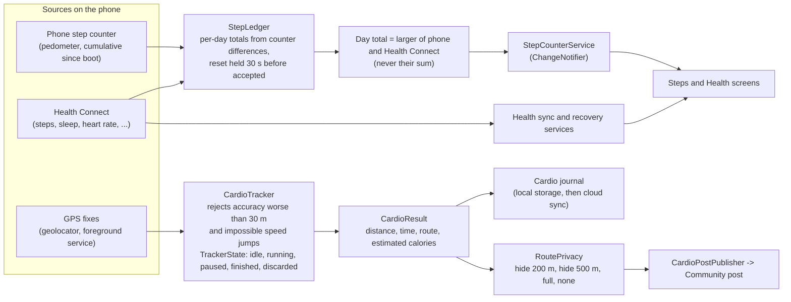
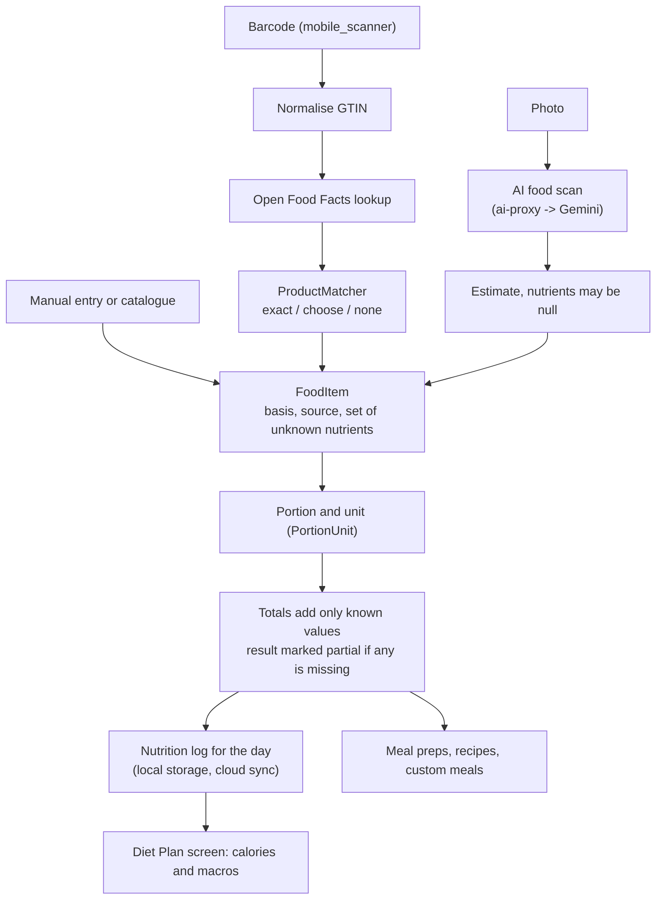
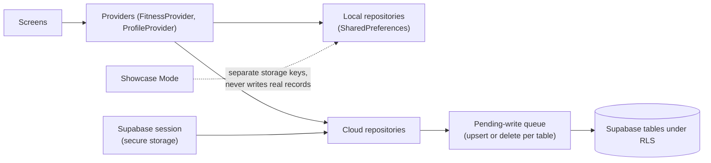

# Feature data flows

How the main features move data, taken from the source code. Class names are real; see the file list at the end.

## Steps, GPS and health data

## Nutrition

## Local storage and cloud synchronisation

## Where this is implemented

| Flow | Main files |
|---|---|
| Steps | `lib/services/steps/step_ledger.dart`, `step_counter_service.dart` |
| GPS cardio | `lib/services/cardio/cardio_tracker.dart`, `route_privacy.dart`, `lib/services/community/cardio_post_publisher.dart` |
| Health Connect | `lib/services/health/` |
| Barcode and food data | `lib/services/food/` (`openfoodfacts_service.dart`, `product_lookup_service.dart`, `product_matcher.dart`) |
| Nutrition models | `lib/models/food_item.dart`, `meal_prep.dart`, `recipe.dart` |
| Local and cloud storage | `lib/data/local/`, `lib/services/cloud/` |
| Showcase Mode | `lib/providers/showcase_mode_provider.dart`, `lib/services/showcase_mode_service.dart` |
