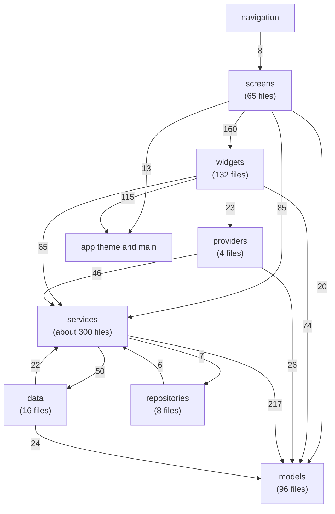

# Flutter module dependencies (measured with Graphify)

This diagram is **not drawn from memory**. It was computed from the Graphify knowledge graph of the repository (`graphify update .`, then `python docs/diagrams/module_dependencies.py`). Graphify extracted the code with its AST pass (every edge is `EXTRACTED`; none is inferred). The script keeps the `imports` edges between Dart files under `lib/`, resolves relative and `package:atlas/` imports, and groups the files by layer. There are **1,306 import edges between files in `lib/`**; the edge labels below are the number of imports from one layer to another.

## What the measurement shows

| Observation | Evidence |
|---|---|
| Screens are built from widgets and call services directly | screens to widgets 160, screens to services 85 |
| State holders sit between widgets and services | widgets to providers 23, providers to services 46 |
| Models are the shared vocabulary | services to models 217, widgets to models 74, providers to models 26 |
| The data layer (local storage and cloud repositories) is used by services | services to data 50 |

## Known deviations from a strict layering

The measurement also shows imports that go against the intended direction. They are listed here because the project reports them honestly rather than presenting an idealised diagram:

- widgets import screens (26 imports), for example to navigate;
- services import providers (7) and widgets (6);
- data imports services (22), and services import data (50), so those two layers are mutually dependent.

These are candidates for refactoring in future work; they do not affect behaviour.

## Largest service areas (files per folder, from the same graph)

`services/ai` 85, `services` root 48, `services/supabase` 12, `services/community` 11, `services/health` 8, `services/lifestyle` 8, `services/ml` 8, `services/cloud` 7, `services/monitoring` 7, `services/athlete` 6, `services/billing` 6, `services/food` 6, `services/nutrition` 6, `services/ranked` 5, `services/steps` 5, `services/cardio` 4.
