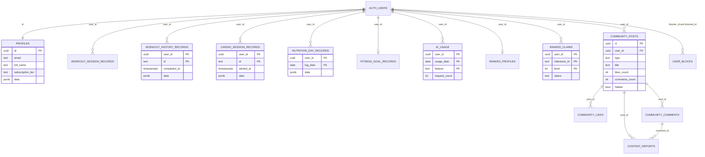

# Supabase backend

Everything here is taken from `supabase/migrations/` and `supabase/functions/`. Nothing in this page was applied or changed by the documentation work.

## Database (14 tables, Row Level Security on every table)

`WORKOUT_SESSION_RECORDS`, `FITNESS_GOAL_RECORDS`, `RANKED_PROFILES`, `RANKED_STAT_RULES`, `COMMENTS`, `LIKES`, `REPORTS` and `USER_BLOCKS` follow the same pattern and are omitted from the field lists to keep the diagram readable.

Design notes:

- The application's own records (workouts, cardio sessions, nutrition days, goals) are stored as a primary key plus a `jsonb data` column, so the client model can evolve without a migration for every field. Rankings and community data use typed columns.
- Every user-owned table references `auth.users` with `ON DELETE CASCADE`, so deleting the user removes their rows.
- `profiles.subscription_tier` can be changed only by the server: a trigger (`protect_subscription_tier`) blocks client updates, and the `revenuecat-webhook` function sets it.
- AI usage is counted per user, day and feature by the database function `consume_ai_quota`.

## Edge Functions

| Function | Purpose | Notes |
|---|---|---|
| `ai-proxy` | The only caller of the Gemini API. Signed-in branch: verifies the user, checks the daily quota, forwards the request. Showcase branch: no user; validates and rebuilds the request, applies limits. | See [ai_request_flows.md](ai_request_flows.md) |
| `delete-account` | Deletes the caller's uploaded files and then the auth user; rows go by cascade | Needs the service key, which exists only on the server |
| `ranked-sync` | Evaluates Ranked milestones from the caller's synced records (never from numbers sent by the app) and records claims | Rank itself is computed by the database from approved claims |
| `revenuecat-webhook` | Receives store purchase events and sets `profiles.subscription_tier` | Authenticated by a shared secret, not by a user token |

## Secrets used by the functions (names only)

`GEMINI_API_KEY`, `SHOWCASE_AI_ENABLED`, `SHOWCASE_PUBLIC_KEYS` (optional), `REVENUECAT_WEBHOOK_SECRET`. The platform injects `SUPABASE_URL`, `SUPABASE_ANON_KEY` and `SUPABASE_SERVICE_ROLE_KEY` (and the newer publishable and secret key variables). No secret values are stored in this repository.
