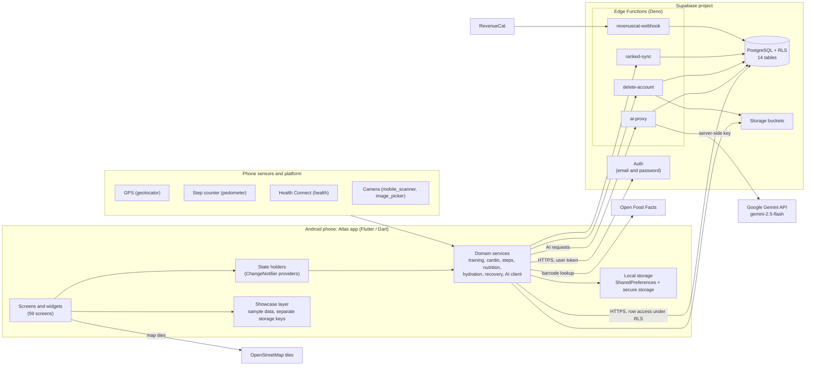

# System architecture

Atlas is an Android application written in Flutter. It keeps most state on the phone and uses a Supabase project for accounts, synchronised records and one server-side function that is the only component allowed to call the Gemini AI service.

**How to read it.** The left block is the application. The Gemini key exists only as a Supabase secret, so the application never holds an AI key. The subscription tier in the database is written only by the RevenueCat webhook.

**Source of the components.** Edge Functions: `supabase/functions/`. Tables: `supabase/migrations/`. Plugins: `pubspec.yaml`. Layers: `lib/` (see [flutter_module_dependencies.md](flutter_module_dependencies.md) for the dependency counts measured with Graphify).
