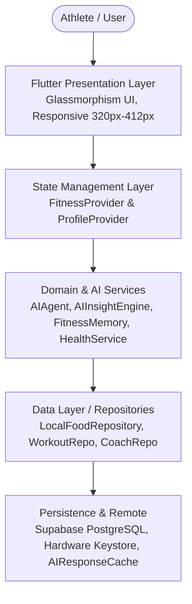

# Atlas — AI-Powered Fitness Ecosystem

[](https://flutter.dev)
[](https://dart.dev)
[](https://deepmind.google/technologies/gemini/)
[]()
[]()
[]()

**Atlas** is an intelligent, autonomous mobile fitness platform engineered with Flutter. Built from the ground up for serious athletes and everyday fitness enthusiasts, it bridges the gap between passive tracking and active, intelligent coaching.

---

## 🌟 Key Capabilities

### 🤖 1. Autonomous AI Fitness Coach
- **Gemini Function Calling Agent**: Orchestrates multi-turn tool execution across workouts, nutrition, health, and progress domains.
- **Explainable AI Reasoning**: Transparent "Why am I seeing this?" cards breakdown physiological and telemetry inputs behind every suggestion.
- **Action Confirmation Gates**: Ensures user consent and full preview before any workout or nutrition modification is applied.

### 🧠 2. Long-Term Fitness Memory
- **Behavioral Learning Engine**: Remembers athlete exercise preferences, avoided movements, session duration, and coach personalities.
- **Dynamic Preference Scoring**: Bidirectional scoring (+1 on accepted substitutions, -1 on replaced movements) automatically demoting disliked exercises.
- **Dual Feedback Pipeline**: Interactive "👍 Helpful / 👎 Not useful" buttons for continuous model personalization.

### 🏋️ 3. Periodized Workout Programming
- **Equipment-Aware Generator**: Tailors workouts for Commercial Gym, Dumbbells, Resistance Bands, or Calisthenics.
- **Live In-Gym Tracker**: Real-time rest timers, set/rep checkboxes, RPE logs, and instant PR detection.
- **100+ Exercise Library**: Detailed movement catalog with muscle group targeting and video form guidance.

### 🥗 4. Nutrition Intelligence
- **150+ Food Database**: Sub-10ms fuzzy searching across whole foods, regional Mizo recipes, and Indian meals.
- **Barcode Scanner**: Camera scanning integrated with Open Food Facts.
- **Adaptive Macro Rings**: Real-time visual protein, carbohydrate, fat, and hydration tracking.

### 💓 5. Biometric Health Recovery
- **0–100 Recovery Readiness Score**: Composite score computed from sleep stages, resting heart rate, and training fatigue.
- **Google Health Connect & Apple Health**: Seamless background telemetry synchronization.
- **Deload Proactive Alerts**: Identifies overtraining windows and recommends restorative active recovery.

### 🏆 6. Community & Gamification
- **Ranked Season Tiers**: Bronze, Silver, Gold, Platinum, Diamond, and Elite leagues.
- **Gym Social Feed**: Share PR achievements, completed workouts, and celebrate milestones with gym peers.

---

## 🏛️ System Architecture



---

## ⚡ Engineering & Quality Metrics

- **731 Automated Tests**: 100% test pass rate across unit, widget, and performance benchmark suites.
- **0 Static Analyzer Issues**: Clean Dart codebase adhering to strict pedantic lints.
- **~121ms Cold App Launch**: High-efficiency dependency composition and pre-cached tab views.
- **Sub-10ms Food Search**: Instant in-memory fuzzy search across 150+ food items.
- **Zero Overflow Layouts**: Verified 100% responsive across 320px, 360px, 390px, and 412px viewports.

---

## 🎬 90-Second Demo Storyboard

```
0:00 - 0:15 | The Problem & Dashboard Overview
0:15 - 0:35 | Autonomous AI Coach & Tool Calling Workflow
0:35 - 0:55 | Live Workout Session, Rest Timers & Form Guides
0:55 - 1:15 | Nutrition Dashboard, 150+ Food Search & Barcode Scanner
1:15 - 1:35 | Health Recovery Telemetry, Sleep & Readiness Score
1:35 - 1:50 | Community Hub, PR Celebrations & Ranked Arena
1:50 - 2:00 | Outro & Engineering Summary
```

---

## 📚 Project Documentation Links

- [Complete Architecture Specification](../ARCHITECTURE.md)
- [Feature Catalog & System Specs](../FEATURES.md)
- [Performance & Benchmark Audit](../PERFORMANCE_AUDIT.md)
- [Codebase Cleanup Report](../CODEBASE_CLEANUP_REPORT.md)
- [Screenshot Guide & UI Index](screenshots/README.md)
- [Demo Script & Storyboard](../DEMO_SCRIPT.md)
- [Software Engineering Resume Entry](../PORTFOLIO_FINAL.md)

---

## 📄 License & Source Code

- GitHub Repository: [BenjaminLRD/Gym-app](https://github.com/BenjaminLRD/Gym-app)
- License: MIT License
