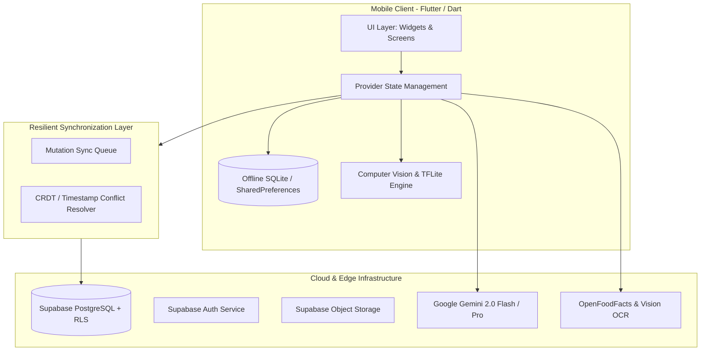
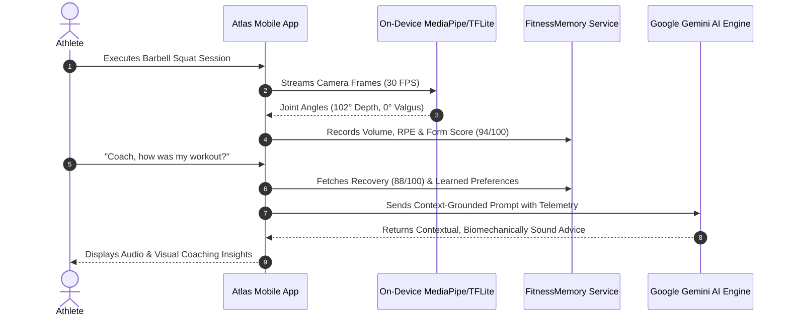
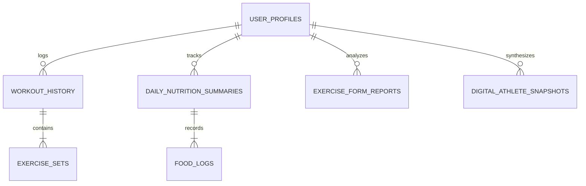
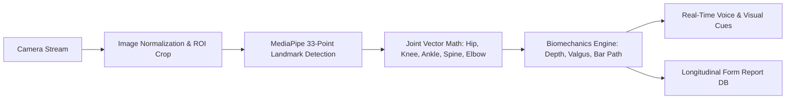

# Atlas — System Architecture & Technical Specification

## 1. Executive Technical Summary

Atlas is an enterprise-grade AI fitness and digital athlete platform. It combines cross-platform mobile engineering (Flutter/Dart) with hybrid artificial intelligence (Google Gemini 2.0 + on-device TensorFlow Lite), real-time computer vision (MediaPipe 33-point pose estimation), and a high-throughput reactive backend (Supabase PostgreSQL with Row-Level Security).



---

## 2. Layered Clean Architecture

Atlas adheres strictly to unidirectional data flow and clean separation of concerns:

```
lib/
├── core/               # App configuration, constants, global error hooks
├── models/             # Immutable data domain models with JSON serialization
├── providers/          # Reactive ChangeNotifier state managers
├── screens/            # Full-page screen composables with AppPage scaffold
├── services/           # Business logic, ML inference, AI prompting, API clients
│   ├── ai/             # Gemini service, Coach prompt builders, ML pipelines
│   ├── analytics/      # Event taxonomy, admin analytics, user behavior tracker
│   ├── athlete/        # Digital athlete state engine, 1RM progression predictors
│   ├── form_detection/ # MediaPipe 33-pt pose landmarks & biomechanics math
│   ├── nutrition/      # Meal logging, macro compliance, barcode lookup
│   └── supabase/       # Database models, table mappers, offline sync queue
├── theme/              # Centralized design tokens (AppColors, AppTypography)
└── widgets/            # Atomic, reusable design system components
```

---

## 3. Hybrid AI Architecture

Atlas utilizes a two-tier hybrid AI architecture:

1. **On-Device Inference Tier (<20ms latency)**:
   - MediaPipe 33-point pose estimation & joint angle trigonometry.
   - TensorFlow Lite heuristic models: workout volume regression, movement quality grading, and churn prediction.
2. **Cloud Generative Tier (<650ms latency)**:
   - Google Gemini 2.0 with context-grounded prompt engineering.
   - Dynamic prompt injection incorporating the user's 7D feature vector, historical volume fatigue, learned dietary preferences, and safety guardrails.



---

## 4. Database Architecture & Row-Level Security (RLS)

The Supabase PostgreSQL backend is partitioned into relational domains with strict security:

| Domain | Primary Tables | Security Model |
|---|---|---|
| **Athletes & Auth** | `user_profiles`, `user_goals`, `user_preferences` | User ID isolation (`auth.uid() = user_id`) |
| **Workouts** | `workouts`, `workout_history`, `exercise_sets`, `personal_records` | User isolation + Read-only public templates |
| **Biomechanics** | `pose_analyses` | Private telemetry isolation |
| **Nutrition** | `food_logs`, `daily_nutrition_summaries`, `custom_foods` | User isolation + global cached food items |
| **Intelligence** | `analytics_events`, `beta_feedbacks`, `ml_training_events` | User-appendable + Admin-read policies |



---

## 5. Offline-First Synchronization Engine

Atlas operates seamlessly without active internet connections:

1. **Local-First Writes**: All workout logs, food entries, and health metrics commit immediately to local SQLite storage.
2. **Mutation Sync Queue**: Mutations are enqueued with unique cryptographic UUIDs and idempotency tokens.
3. **Conflict Resolution**: Last-Write-Wins (LWW) utilizing monotonic client and server timestamp reconciliation.
4. **Exponential Backoff**: Transient network failures trigger retries with exponential jitter $(2^n + \text{rand}(0, 100)\text{ms})$.

---

## 6. Computer Vision & Pose Biomechanics Pipeline

The exercise form analysis engine processes high-resolution video streams:



- **Squat Kinematics**: Computes hip flexion angle relative to knee plane ($\text{Depth} \le 105^\circ$), knee valgus lateral displacement ($< 5\%$).
- **Bench Press Kinematics**: Elbow flare angle relative to torso ($45^\circ - 60^\circ$ target), chest touch pause duration ($> 300\text{ms}$).
- **Deadlift Kinematics**: Lumbar curvature deviation ($\le 8^\circ$), bar velocity acceleration profiles.
